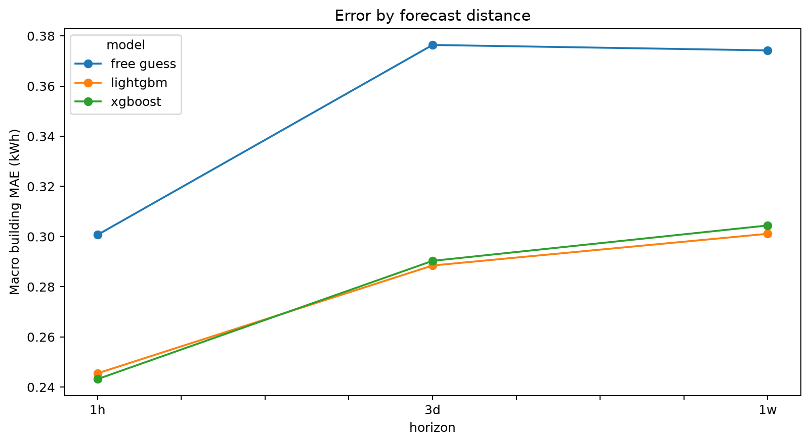

# enggmodel — household electricity forecasting

One Python pipeline forecasts **half-hourly electricity consumption (kWh)** at **1 hour, 3 days and 1 week ahead**, using LightGBM and XGBoost. It consumes the schema from [Eason's data-processing project](https://github.com/eaych/energy-building-data-processing).


## Completed experiment

The public SGSC source was prepared into a 1,500-household, customer-disjoint split. Before model selection, fixed random cohort caps selected **100 learning, 30 fine-tuning and 30 final-test households**. Each horizon evaluated 485,250 half-hour targets in the same held-out test cohort. Three settings per library/horizon produced 18 documented tuning fits. Settings were selected on fine-tuning macro MAE, locked, and evaluated on test households once.

Results below show the lower **macro MAE** of the two ML models at each horizon. Macro MAE means computing each household's MAE first and then averaging households equally. All six ML model/horizon combinations beat their matching historical-reading baseline on this cohort.

| Horizon | Lower-MAE ML model | Model macro MAE (kWh) | Free-guess macro MAE (kWh) | Error reduction |
| --- | --- | --- | --- | --- |
| 1 hour | XGBoost | 0.243183 | 0.300694 | 19.1% |
| 3 days | LightGBM | 0.288472 | 0.376396 | 23.4% |
| 1 week | LightGBM | 0.301116 | 0.374228 | 19.5% |

Source: [results.csv](multihorizon_outputs/results.csv). [Table 2](multihorizon_outputs/table2.md) includes every model/horizon, RMSE and pooled R². These results describe a held-out household cohort within the same calendar year; they are not a prospective future-year test or evidence of population-wide accuracy. The publisher's source already contains filled missing readings; see the [methods and limitations](multihorizon_outputs/modelling_methods.md).



## Read and use the completed work

- [Report sections: Methods, headline results, Table 2 and executed settings](multihorizon_outputs/report_sections.md)
- [Joseph/Regina handover](multihorizon_outputs/HANDOVER.md)
- [Starter notebook](notebooks/predictions_starter.ipynb)
- [Source changes and assumptions](docs/handover_notes.md) and [oral research notes](docs/research_notes.md)
- [Saved-output verification](multihorizon_outputs/verification_summary.json)
- Six fitted model bundles in [models/](multihorizon_outputs/models/)

The complete prediction exports are stored compressed in [artifacts/](artifacts/). Restore them locally without downloading source data or training anything:

```bash
python restore_predictions.py
```

This creates `multihorizon_outputs/predictions.csv` and `predictions_wide.csv`, checking their SHA-256 hashes against the completed experiment. The long file contains 4,367,250 rows with `building_id, timestamp, horizon, model, actual_kwh, forecast_kwh`. The wide file contains 1,455,750 rows with all three forecasts side by side. Allow about 355 MB for the restored files.

To run checks and starter figures (tested with Python 3.14.7):

```bash
python -m venv .venv
source .venv/bin/activate
python -m pip install -r requirements-lock.txt
python restore_predictions.py
python verify_saved_results.py
python run_analysis_starter.py
python -m pytest -q
```

The last plot command runs the notebook's Python cells without requiring Jupyter. For an interactive notebook, separately install `notebook` and `ipykernel`, or use a configured VS Code notebook environment. The fitted models use the package versions recorded in [runtime_versions.json](multihorizon_outputs/runtime_versions.json); load only model bundles you trust.

## Reproduce from public sources

The published `multihorizon_outputs/` folder is deliberately locked. Do not delete its final-test markers or overwrite its settings after seeing test results. A fresh run is a **reproduction of an already published experiment**, not another untouched final test. Use separate directories:

```bash
python download_energy_data.py
python prepare_energy_data.py --output-dir data/reproduction_cleaned

python run_multihorizon.py --stage tune --horizon all \
  --data-dir data/reproduction_cleaned --output-dir reproduction_outputs

python verify_lag_spot_check.py --output-dir reproduction_outputs

python run_multihorizon.py --stage final --horizon all \
  --data-dir data/reproduction_cleaned --output-dir reproduction_outputs

python generate_run_report.py \
  --data-dir data/reproduction_cleaned --output-dir reproduction_outputs

python verify_saved_results.py --output-dir reproduction_outputs
```

`--horizon` is the forecast-distance dial: `1h`, `3d`, `1w` or `all`. The official experiment runs `all` together. Tuning never opens the test split; both tuning and final evaluation refuse to proceed after a final-test lock exists in their output directory. All attempted settings are saved in `validation_trials.csv`.

The download includes approximately 990 MB of SGSC interval records, supporting dwelling indices and all 12 AEMO NSW monthly files for 2013. Preparation requires several GB of disk space, verifies the publisher's interval-file checksum, processes households separately to limit RAM, fixes the split seed, and refuses to overwrite frozen outputs. Raw and prepared large CSVs are excluded from Git.

## Forecast availability and interpretation

At target time T, predictors contain only consumption timestamped at or before T minus the horizon. Lags are reconstructed by exact timestamp rather than row position. Target calendar information is known in advance; realised future market price and system demand are excluded. Household IDs are grouping keys rather than model inputs. The benchmark is the reading 1 hour, 3 days or 1 week before the target, matching the horizon.

Equal household weighting does not remove consumption-scale differences. Source imputation timing and SGSC/AEMO interval-label/DST conventions remain limitations. The notebook's apartment example is selected by customer ID independently of forecast error; it must not be called the team's own apartment without confirming that customer's ID. Feature importance describes model use, not causation, and its scales differ between libraries.

## Sources and attribution

- Roberts, M.; Haghdadi, N.; Bruce, A.; MacGill, I. (2019), *Clustered residential electricity load profiles from Smart Grid Smart City dataset*, Mendeley Data V1, [DOI: 10.17632/zm4f727vvr.1](https://doi.org/10.17632/zm4f727vvr.1), CC BY 4.0. This project samples households, casts readings to float32, joins market records, builds lags, and produces model-derived forecasts.
- Australian Energy Market Operator: public historical NSW price-and-demand records, accessed through the monthly source URLs recorded by `download_energy_data.py`.
- Eason Chen's [energy-building-data-processing](https://github.com/eaych/energy-building-data-processing): source schema and preparation workflow. See [third-party notices](THIRD_PARTY_NOTICES.md).
